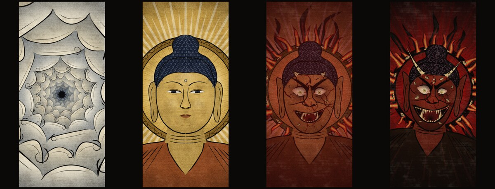

# 昇天 ― 雲ヲ抜ケ、仏ニ見ユ

渦巻く雲の底から、長押しで昇り、仏に会い、裁かれる。
浮世絵と地獄草紙の筆致をコードで描く、完全プロシージャルなインタラクティブ・ホラーアート。

画像・音声・外部フォントは一切読み込まない。画面のすべて（雲のトンネル、螺髪の仏、鬼神、
炎、和紙の質感、鬨の音）は Canvas 2D と Web Audio がその場で合成している。



**デモ: https://shouten.vercel.app**

## 遊び方

| 操作 | 効能 |
| --- | --- |
| **長押し**（画面 / Space キー） | 雲の穴へ昇る。離すと堕ちる。 |
| **M** ／ 右下の「音」 | 消音の切り替え |

上昇中は「一丈・二丈……」と高度が表示される。雲を抜けると、あとは見ているしかない。

## 構成

```
src/
  main.tsx          入口（React を吊るすだけ）
  App.tsx           UI 層の殻。canvas と Experience の寿命を管理
  app/Experience.ts 合成ルート。状態・描画・音響を配線しフレームループを回す
  state/            Timeline（演出タイムライン兼ステートマシン）と型契約
  render/           Renderer（合成）と各場面の筆致
                    CloudTunnel / Deity / DeityFeatures / Halo / Flames / HellFall
                    Brush（墨のかすれ） / PaperTexture（和紙）
  audio/AudioEngine.ts  オシレータとノイズのみのリアルタイム音響合成
  ui/               Overlay（縦書きの言葉） / InputController（長押しの正規化） / kanji
```

設計の要は「互いを知らない」こと。`Timeline` は毎フレーム `FrameState` を吐くだけで、
`Renderer` と `AudioEngine` はその値しか読まない。UI へは変化のあったときだけ
`UiSnapshot` を通知する。演出をいじるなら `Timeline.ts` の一箇所で済む。

## 開発

```bash
npm install
npm run dev        # http://localhost:5173
npm run build      # 型検査 + 本番ビルド（dist/）
npm run preview    # ビルド結果を確認
npm run smoke      # ブラウザ無しで全フェーズを描画し smoke-out/ に PNG を書き出す
```

`npm run smoke` は `@napi-rs/canvas` をその場で導入して描画エンジンだけを走らせる、
見た目の退行チェック用の補助スクリプト（製品コードには含まれない）。

## デプロイ

Vercel（Vite プリセット）。`vercel.json` にビルド設定を含めてあるので、
リポジトリを繋げばそのまま公開される。

## 演出の流れ

1. **上昇** — 渦巻く雲のトンネル。押し続けるほど指数関数的に加速し、雲が汚れていく。
2. **雲抜け** — 白飛び。金箔の虚空に、螺髪の仏が顕現する。
3. **審判** — 心臓の鼓動に合わせて瞳がこちらへ焦点を結び、黄金が退色する。操作不能。
4. **変貌** — 白黒反転と血の閃光。仏が角と牙と無数の眼を持つ鬼神へ崩れる。
5. **墜落** — 雷、亡者の腕、炎の渦。地平が回り、血と闇に呑まれる。
6. **回帰** — また雲の底。高度は零に戻る。

「また、昇るか」
